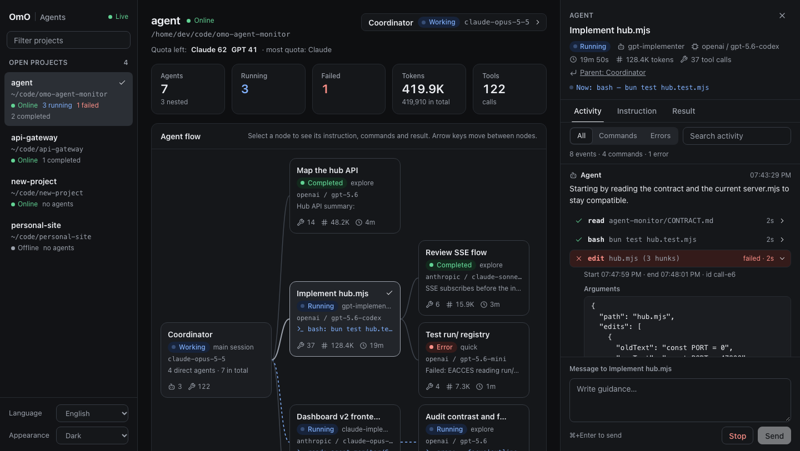

# OmO Agent Monitor

A live, local dashboard for [OmO](https://omo.dev) agents. It brings every open
session together in one place and shows each project's flow: the coordinator,
its agents and sub-agents. For every agent you see its instruction, what it is
doing right now, and each tool call with its arguments and result. From the
dashboard you can also steer agents and stop them.

**English** | [Português](README.pt-BR.md)



## Install

```sh
omo install git:github.com/caikpigosso/omo-agent-monitor
```

Open a new OmO session. The dashboard starts on its own; to get its address, run
this inside the session:

```text
/monitor
```

Open **http://127.0.0.1:47800/** in your browser. Every new OmO session shows up
there automatically, even across different projects.

To try it without installing, for this run only:

```sh
omo -e git:github.com/caikpigosso/omo-agent-monitor
```

### Requirements

- OmO 5.1.33 (tested version). Tested on macOS; Linux should work but has not
  been tested yet.
- `tmux`, only for the terminal panes (`/monitor tmux`).
- Nothing else: the dashboard runs on OmO's own binary, with no Bun, Node or
  `npm install` needed.

## Usage

| Command | What it does |
| --- | --- |
| `/monitor` | Shows the dashboard link for this session. |
| `/monitor tmux` | Also opens a tmux session with one pane per agent; type to steer the agent, `/abort` stops it. |
| `/monitor stop` | Closes this session's tmux readers. The dashboard and the agents keep running. |

In the browser:

- **Projects:** the sidebar lists every open session, whether it is online, and
  how many agents are running, finished or failed.
- **Flow:** click a node (coordinator or agent) to open its details.
- **Activity:** the instruction is pinned at the top; each tool call expands to
  show its arguments and result. Filters (All, Commands, Errors) and search.
- **Controls:** send the agent a message (Cmd/Ctrl+Enter), stop the agent, or
  talk to the project's coordinator.
- **Themes:** light, dark or system; works on phones too.
- **Language:** English by default. Switch to Portuguese with the **Language**
  selector in the sidebar; the choice is saved in the browser. To make Portuguese
  the default everywhere, including `/monitor` and tmux, set
  `OMO_MONITOR_LANG=pt-BR` before starting OmO.

## Update and remove

To update, remove and install again, then open a new session:

```sh
omo remove git:github.com/caikpigosso/omo-agent-monitor
omo install git:github.com/caikpigosso/omo-agent-monitor
```

To remove it for good, run only the first command. After removal the hub may
keep running until you restart the computer or stop it:
`pkill -f omo-agent-monitor/src/hub.mjs`.

## Configuration (optional)

| Variable | Default | Purpose |
| --- | --- | --- |
| `OMO_MONITOR_LANG` | `en` | Default language: `en` or `pt-BR`. |
| `OMO_MONITOR_PORT` | `47800` | Hub port. |
| `OMO_MONITOR_RUN_DIR` | `~/.omo/agent/agent-monitor/run` | Where each session registers. |
| `PI_CODING_AGENT_DIR` | `~/.omo/agent` | OmO config directory, if you use another one. |
| `OMO_MONITOR_QUOTA_MODULE` | — | Module exporting `readCoordinator()` to show quotas in the header. |

## How it works

Each OmO session starts an internal server on a random port and registers it in
`~/.omo/agent/agent-monitor/run/`. A hub on `127.0.0.1:47800` reads that
registry, follows each session live and serves the page. The hub keeps running
when the session that started it ends, and the next session reuses it. API
details are in [docs/API.md](docs/API.md) and the design in
[docs/DESIGN.md](docs/DESIGN.md).

## Security

- Everything listens on `127.0.0.1` only; nothing leaves your machine.
- Sending messages and stopping agents require a token generated each time the
  hub starts, and requests from other origins are refused.
- Reading needs no token: any program running on your machine can read the
  transcripts through the local address. Do not use it on shared machines.

## Troubleshooting

- **A session does not show up:** it was opened before the install. Open a new
  session.
- **Project marked Offline:** the session closed or is restarting the dashboard;
  it comes back on its own when the session responds.
- **The dashboard does not open:** run `/monitor` in a session; that restarts the
  hub if it stopped. If port 47800 is taken, use `OMO_MONITOR_PORT`.
- **Tokens show as "—":** OmO reports tokens only when the agent finishes.

## License

[MIT](LICENSE)
