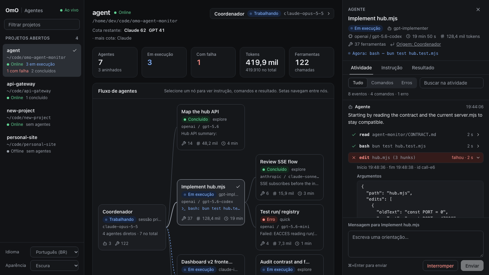

# OmO Agent Monitor

Painel local e ao vivo para os agentes do [OmO](https://omo.dev). Ele junta todas
as sessões abertas num só lugar e mostra o fluxo de cada projeto: coordenador,
agentes e subagentes. Para cada agente aparecem a instrução, o que ele está
fazendo agora e cada comando com argumentos e resultado. Pelo painel você também
manda orientações e interrompe agentes.

[English](README.md) | **Português**



## Instalação

```sh
omo install git:github.com/caikpigosso/omo-agent-monitor
```

Abra uma sessão nova do OmO. O painel sobe sozinho; para ver o endereço, rode
dentro da sessão:

```text
/monitor
```

Abra **http://127.0.0.1:47800/** no navegador. Cada sessão nova do OmO aparece
lá automaticamente, mesmo em projetos diferentes.

Para testar sem instalar, só nesta execução:

```sh
omo -e git:github.com/caikpigosso/omo-agent-monitor
```

### Requisitos

- OmO 5.1.33 (versão testada). Testado no macOS; no Linux deve funcionar, mas
  ainda não foi testado.
- `tmux`, só se quiser os painéis no terminal (`/monitor tmux`).
- Nada mais: o painel roda pelo próprio binário do OmO, sem precisar de Bun,
  Node ou `npm install`.

## Uso

| Comando | O que faz |
| --- | --- |
| `/monitor` | Mostra o link do painel para esta sessão. |
| `/monitor tmux` | Também abre uma sessão tmux com um painel por agente; digite para orientar o agente, `/abort` interrompe. |
| `/monitor stop` | Fecha os leitores tmux desta sessão. O painel e os agentes continuam. |

No navegador:

- **Projetos:** a lista lateral mostra todas as sessões abertas, se estão online
  e quantos agentes estão rodando, concluídos ou com falha.
- **Fluxo:** clique num nó (coordenador ou agente) para abrir o detalhe.
- **Atividade:** a instrução fica no topo; cada comando abre para mostrar os
  argumentos e o resultado. Há filtros (Tudo, Comandos, Erros) e busca.
- **Controles:** mande uma orientação ao agente (Cmd/Ctrl+Enter), interrompa o
  agente ou fale com o coordenador do projeto.
- **Temas:** claro, escuro ou do sistema; funciona no celular também.
- **Idioma:** o painel abre em inglês. Troque para português no seletor
  **Language** da barra lateral; a escolha fica salva no navegador. Para usar
  português por padrão, inclusive em `/monitor` e no tmux, defina
  `OMO_MONITOR_LANG=pt-BR` antes de abrir o OmO.

## Atualizar e remover

Para atualizar, remova e instale de novo; depois abra uma sessão nova:

```sh
omo remove git:github.com/caikpigosso/omo-agent-monitor
omo install git:github.com/caikpigosso/omo-agent-monitor
```

Para remover de vez, rode só o primeiro comando. Ao remover, a central pode continuar rodando até você reiniciar o computador ou
encerrar o processo: `pkill -f omo-agent-monitor/src/hub.mjs`.

## Configuração (opcional)

| Variável | Padrão | Uso |
| --- | --- | --- |
| `OMO_MONITOR_LANG` | `en` | Idioma padrão: `en` ou `pt-BR`. |
| `OMO_MONITOR_PORT` | `47800` | Porta da central. |
| `OMO_MONITOR_RUN_DIR` | `~/.omo/agent/agent-monitor/run` | Onde cada sessão se registra. |
| `PI_CODING_AGENT_DIR` | `~/.omo/agent` | Pasta de configuração do OmO, se você usa outra. |
| `OMO_MONITOR_QUOTA_MODULE` | — | Módulo que exporta `readCoordinator()` para mostrar cotas no topo. |

## Como funciona

Cada sessão do OmO sobe um servidor interno numa porta aleatória e se registra
em `~/.omo/agent/agent-monitor/run/`. Uma central em `127.0.0.1:47800` lê esse
registro, acompanha cada sessão ao vivo e serve a página. A central continua
rodando quando a sessão que a abriu termina, e a próxima sessão reaproveita a
mesma. Os detalhes da API estão em [docs/API.md](docs/API.md) e o design em
[docs/DESIGN.md](docs/DESIGN.md).

## Segurança

- Tudo escuta só em `127.0.0.1`; nada sai da sua máquina.
- Mandar mensagens e interromper agentes exige um token gerado a cada vez que a
  central sobe, e pedidos de outras origens são recusados.
- A leitura não exige token: qualquer programa rodando na sua máquina consegue
  ler as transcrições pelo endereço local. Não use em máquinas compartilhadas.

## Problemas comuns

- **A sessão não aparece:** ela foi aberta antes da instalação. Abra uma sessão
  nova.
- **Projeto marcado como Offline:** a sessão fechou ou está reiniciando o
  painel; ele volta sozinho quando a sessão responder.
- **O painel não abre:** rode `/monitor` numa sessão; isso sobe a central de
  novo se ela tiver parado. Se a porta 47800 estiver ocupada, use
  `OMO_MONITOR_PORT`.
- **Tokens aparecem como "—":** o OmO só informa os tokens quando o agente
  termina.

## Licença

[MIT](LICENSE)
